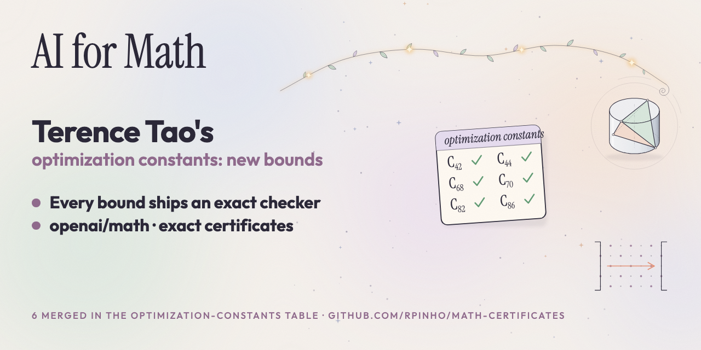

# Math certificates: the paper

Part of my AI-for-science work: [biology](https://github.com/rpinho/ai-biology) · [physics](https://github.com/rpinho/ai-physics).

Explicit, machine-checkable bounds on open optimization constants.

Every result in one file, with its claim, derivation, checks and verdict copied from the result folders: [PAPER.md](PAPER.md).

Start with the [short retro](RETRO.md): what we did, what broke, what I would do differently and where I think this is going.

The certificates, checkers and full proofs are in [rpinho/math-certificates](https://github.com/rpinho/math-certificates/tree/aed5011f71082ab1373bdd8692801dd6cb0ec608), pinned at commit aed5011. Verification levels are defined in [VERIFICATION_LEVELS.md](VERIFICATION_LEVELS.md).

## References

Every result here builds on earlier work. PAPER.md credits it in context; this list collects it.

- Terence Tao and contributors, [optimization-constants table](https://teorth.github.io/optimizationproblems/), with its own references for each constant.
- C22b: Youhua Li, 7.2012719\* ([PR #267](https://github.com/teorth/optimizationproblems/pull/267), merged); Doldrums / SCiEL, 7.087662112\* ([PR #342](https://github.com/teorth/optimizationproblems/pull/342)).
- C30: Norton's unrefereed arXiv v3 bound 10.412263, as recorded in [PR #313](https://github.com/teorth/optimizationproblems/pull/313) (maximusrufus).
- C38: Numaro's span-17 certificate on the [38a page](https://teorth.github.io/optimizationproblems/constants/38a.html); Kesten's irreducible-bridge renewal argument and Jensen's finite-family criterion, as cited there; V. Plánočka's public, unrefereed claim.
- C42: Bakeas, Theorem A ([PR #302](https://github.com/teorth/optimizationproblems/pull/302)); D. Koshta's bound on the [42a page](https://teorth.github.io/optimizationproblems/constants/42a.html); Biró (2000), the strict lower bound, as cited there.
- C44: Wellens, Discrete Analysis 2022:20, and BakeLab/Épi's exact certificates, as cited on the [44a page](https://teorth.github.io/optimizationproblems/constants/44a.html).
- C47: Yongxi Lin's lattice construction and T. S. Tomar's measure and Lemma 6.2 ([Zenodo](https://doi.org/10.5281/zenodo.23716077)); Doldrums / SCiEL, 1.7032090736 ([PR #341](https://github.com/teorth/optimizationproblems/pull/341)).
- C57c: F. Wikström, [arXiv:2610.34580](https://arxiv.org/abs/2610.34580).
- C68: V. Patankar's flux lemma ([PR #274](https://github.com/teorth/optimizationproblems/pull/274)); Wikström's moment criterion, as cited on the [68a page](https://teorth.github.io/optimizationproblems/constants/68a.html).
- C70: V. Patankar's 1.201927 ([PR #226](https://github.com/teorth/optimizationproblems/pull/226), merged).
- C82: C. Doche, [Zhang-Zagier heights of perturbed polynomials](https://www.numdam.org/item/JTNB_2001__13_1_103_0/), J. Théor. Nombres Bordeaux 13 (2001), 103–110; Grinsztajn's and Épi's factor libraries ([82a page](https://teorth.github.io/optimizationproblems/constants/82a.html)); V. Patankar's certificates, numerator bank, iterated LLL numerator search and closest-vector method ([PR #280](https://github.com/teorth/optimizationproblems/pull/280)).
- C86: D. Koshta's bound on the [86a page](https://teorth.github.io/optimizationproblems/constants/86a.html); V. Patankar ([PR #270](https://github.com/teorth/optimizationproblems/pull/270)); Tomar's preprint, as cited there.
- C89b, C89c: Jeetu SK ([PR #277](https://github.com/teorth/optimizationproblems/pull/277), [PR #279](https://github.com/teorth/optimizationproblems/pull/279)); the Feinstein–Even-Zohar announcement and de Caen's bound, as discussed in those rows.
- C91, C31b: Leandre Jack ([PR #273](https://github.com/teorth/optimizationproblems/pull/273), [PR #272](https://github.com/teorth/optimizationproblems/pull/272)).
- C10a: Heilman–Jones–Malavolta and Peng, as recorded in [PR #300](https://github.com/teorth/optimizationproblems/pull/300).
- Tetrahedron cylinder cover: [openai/math problem 100](https://github.com/openai/math/blob/main/lean/docs/100.md).
- Independent replays of many rows: Arhan Canli ([quantavane-replays](https://github.com/arhancanli/quantavane-replays)), linked per row above.

## License

MIT, see [LICENSE](LICENSE). Third-party files keep their own terms; each is listed in the THIRD_PARTY_NOTICE.md or THIRD_PARTY_NOTICES.md file next to it.
